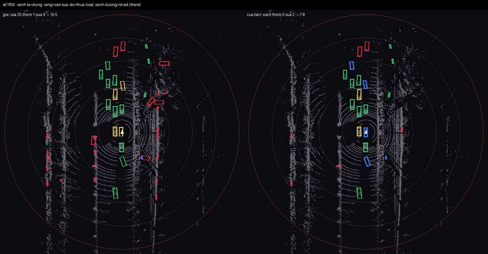
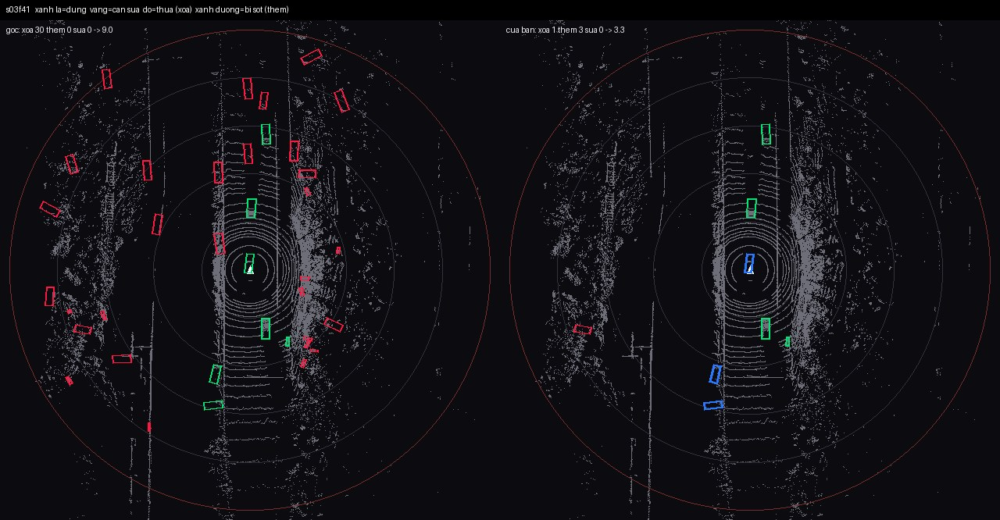
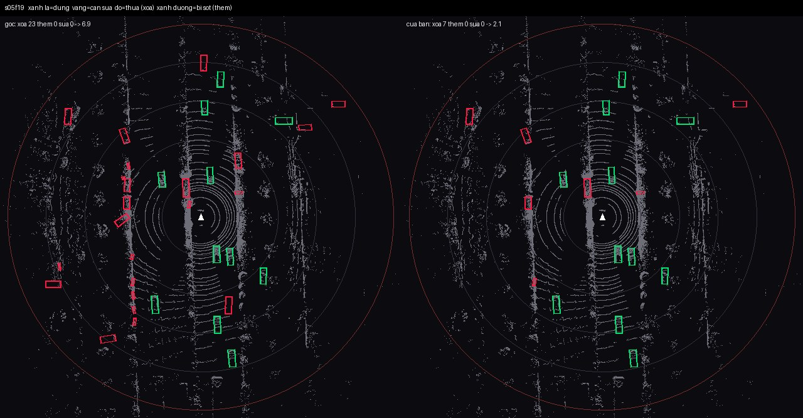

# Báo cáo Day 14 — Phạm Việt Hoàng — 2A202603254

- Mã học viên dùng với `--student`: `2A202603254`
- `seed_tag` trong `frames_A.txt`: `82ac3100fd`

## 1. Dự đoán trước sweep (bước 5b)

- Tham số tôi nghĩ giảm công sửa nhiều nhất: `score_thr`. Tôi dự đoán tăng `score_thr` lên 0.4 và đặt `min_points=5` sẽ giúp giảm công sửa.

- Vì sao: Khi quan sát ảnh BEV và chỉnh sửa trên CVAT, tôi thấy mô hình sinh nhiều cuboid thừa, đặc biệt là lớp Cyclist tại các khu vực cây xanh và ven đường. Ở frame s01f59, số cuboid giảm từ 42 xuống còn 18 sau khi chỉnh sửa, trong đó Cyclist giảm từ 19 xuống còn 4. Tôi dự đoán tăng ngưỡng confidence và lọc các cuboid có ít điểm LiDAR sẽ giảm số hộp cần xóa. Tuy nhiên, ngưỡng quá cao có thể làm mất các vật thể thật bị che khuất hoặc có ít điểm LiDAR.

## 2. Tập A: sửa tay và tune

| Cấu hình | Xóa | Thêm | Sửa | Chi phí |
|---|---:|---:|---:|---:|
| Gốc | 78 | 1 | 4 | 26.4 |
| `best_config.json` | 14 | 8 | 2 | 13.2 |

- Tham số đã đổi trong `best_config.json`: `score_thr` từ 0.1 lên 0.5 và `min_points` từ 0 lên 10. Các tham số còn lại giữ nguyên.

- Kết quả leave-one-out:

```text
s01f59: cấu hình chọn {'score_thr': '0.5', 'min_points': '10'} → 7.8 (tốt nhất có thể 7.5)
s03f41: cấu hình chọn {'score_thr': '0.5', 'min_points': '10'} → 3.3 (tốt nhất có thể 3.3)
s05f19: cấu hình chọn {'score_thr': '0.5', 'min_points': '10'} → 2.1 (tốt nhất có thể 2.1)
```

- Cấu hình tương đối ổn định trên tập A vì cả ba lần leave-one-out đều chọn `score_thr=0.5` và `min_points=10`. Hai frame s03f41 và s05f19 đạt chi phí thấp nhất có thể, còn s01f59 chỉ cao hơn 0.3. Tôi vẫn chọn cấu hình này vì có tổng chi phí thấp nhất trong 15 cấu hình đã thử.

## 3. Trước/sau (bước 8)

### Frame s01f59



### Frame s03f41



### Frame s05f19



- `scripts/pp_compare.py` báo giảm 50% công sửa trên tập A, từ 26.4 xuống 13.2.

| Frame | Chi phí gốc | Chi phí sau tune |
|---|---:|---:|
| s01f59 | 10.5 | 7.8 |
| s03f41 | 9.0 | 3.3 |
| s05f19 | 6.9 | 2.1 |
| Tổng | 26.4 | 13.2 |

- Dự đoán ở mục 1 đúng về xu hướng nhưng chưa đúng hoàn toàn về giá trị tham số tối ưu. Cấu hình dự đoán ban đầu `score_thr=0.4`, `min_points=5` có chi phí 17.7, trong khi cấu hình tốt nhất có chi phí 13.2.

- Sau khi tối ưu, số box cần xóa giảm từ 78 xuống 14 và số box cần sửa giảm từ 4 xuống 2. Tuy nhiên, số box cần thêm tăng từ 1 lên 8. Điều này cho thấy việc tăng ngưỡng lọc giúp loại bỏ nhiều dự đoán thừa nhưng cũng làm bỏ sót thêm một số vật thể. Tổng chi phí sửa vẫn giảm đáng kể.

## 4. Tập B

Số đo từ `scripts/pp_prelabel.py --frames d14_2A202603254/frames_B.txt --config d14_2A202603254/best_config.json --gt d14_2A202603254/ref_B.json`:

| Xóa | Thêm | Sửa | Chi phí |
|---:|---:|---:|---:|
| 34 | 12 | 2 | 23.2 |

- Số frame: 12.
- Số box dự đoán: 180.
- Số box tham chiếu: 158.
- Số box khớp: 146.
- Chi phí sửa trung bình mỗi frame: 1.93.

- Thao tác xuất hiện nhiều nhất là xóa box thừa với 34 box. Tuy nhiên, thao tác thêm box bị bỏ sót có tổng chi phí cao nhất là 12, so với chi phí xóa là 10.2 và chi phí sửa là 1.0. Hai frame có chi phí cao nhất là s02f19 và s03f21, cùng bằng 3.8.

## 5. Giới hạn

- Tập A chỉ có 3 frame nên cấu hình tối ưu có thể chưa đại diện đầy đủ cho toàn bộ dữ liệu VF LiDAR.
- PointPillars được huấn luyện trên KITTI với ba lớp chính là Car, Cyclist và Pedestrian. Truck và Bus không phải các lớp được mô hình học trực tiếp nên vẫn cần kiểm tra và chỉnh sửa thủ công.
- Chi phí sửa được tính theo công thức có trọng số, chưa phản ánh chính xác thời gian thực tế khi chỉnh sửa trên CVAT.
- Việc tăng ngưỡng confidence và số điểm LiDAR tối thiểu có thể làm mất các vật thể thật ở xa hoặc bị che khuất.
- Nhãn tham chiếu được chỉnh sửa thủ công nên vẫn có thể tồn tại sai sót về phân loại, kích thước hoặc hướng xoay của cuboid.
